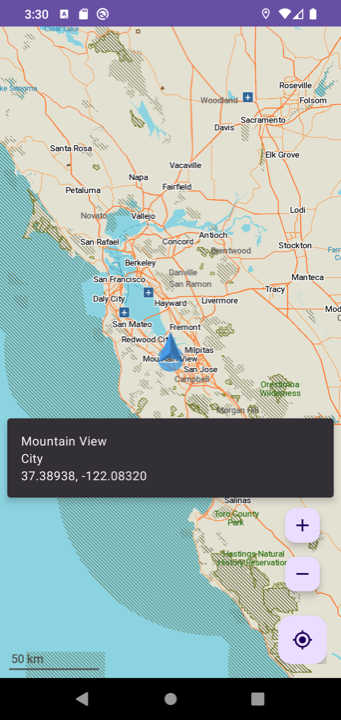
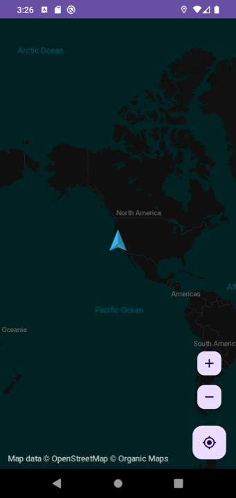
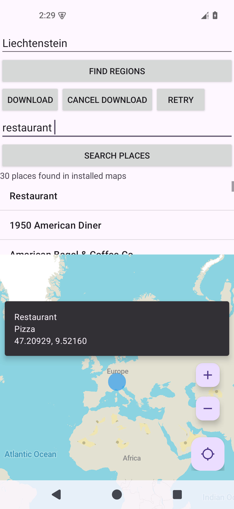
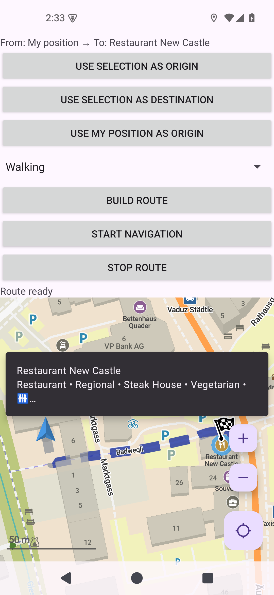

# Organic Maps Android SDK

## Disclaimer

Note that Organic Maps SDK API can change at any time (because SDK component is a part of the main Organic Maps app).
We do not guarantee API stability, and do not have enough resources to support legacy code.

## Organic Maps Android SDK examples

Three independently installable Android samples share the map and lifecycle setup:

| Variant   | Integration demonstrated |
|-----------|--------------------------|
| `basic`   | Map rendering, location permission, position modes, place selection, themes and insets |
| `offline` | Region-name search, downloads, progress, cancellation/retry, and offline POI search |
| `routing` | Selected endpoints, walking/cycling/driving, build progress/errors, missing maps and foreground navigation |

| Light map and place information | Dark map |
|:---:|:---:|
|  |  |

These screenshots show the basic integration. Additional variants expose controls
in a scrollable panel above the map.

| Offline restaurant search | Walking route preview |
|:---:|:---:|
|  |  |

## Build from a fresh SDK checkout

Use JDK 21, Android SDK Platform 37 and an API 21+ device or emulator. The sample
build needs no NDK: native libraries are supplied by the SDK AAR. A native stripping
warning here does not imply that the producer shipped debug symbols; the SDK
producer is responsible for stripping its libraries.

Until the SDK is publicly released, build its source and use an isolated Maven
repository. With Organic Maps in a sibling `organicmaps` directory:

```bash
cd ../organicmaps/android
./gradlew -Parm64 -PsdkVersion=0.0.0-sdk-check publishSdkForChecks
cd ../../sdk-android
./gradlew -PsdkRepository=../organicmaps/android/build/sdk-check/repository -PsdkVersion=0.0.0-sdk-check checkSamples
```

`-Parm64` publishes for arm64 devices/emulators; use `-Px86_64` for an Intel emulator.
These flags affect the producer. Samples package the ABIs supplied by the AAR.

`sdkRepository` restricts the SDK group to that repository, preventing a stale
`mavenLocal()` or Central artifact from satisfying a check. `sdkVersion` overrides
`gradle/libs.versions.toml`. Without `sdkRepository`, normal Maven repositories and
`mavenLocal()` are used. After a public release, select the released version.

Install an individual variant, retaining the same repository/version options:

```bash
./gradlew -PsdkRepository=../organicmaps/android/build/sdk-check/repository :app:installBasicDebug
./gradlew -PsdkRepository=../organicmaps/android/build/sdk-check/repository :app:installOfflineDebug
./gradlew -PsdkRepository=../organicmaps/android/build/sdk-check/repository :app:installRoutingDebug
```

`checkSamples` checks Kotlin style, builds debug and minified release APKs for all
variants, and runs lint. CI builds a fresh SDK source ref and runs the same command
on pushes and pull requests, without Central credentials. The manual workflow's
`sdk_ref` input selects an upstream branch or tag.

## Shared setup

[ExampleApplication](app/src/main/java/app/organicmaps/example/ExampleApplication.kt)
creates one SDK instance and owns map-loading readiness. Activities observe that
state through their lifecycle. Repeating `OrganicMaps.init()` returns false without
replaying its callback, including while the first asynchronous load is pending;
application-owned readiness therefore also handles rotation during initial loading.

[MainActivity](app/src/main/java/app/organicmaps/example/MainActivity.kt) binds a
`MapController`, forwards lifecycle and widget insets, chooses light/dark styles,
and handles location permissions. It aliases the SDK `Map` as `OMMap` to avoid the
Kotlin collection-name clash. `app/build.gradle.kts` demonstrates core-library
desugaring and uncompressed `mwm`, `ttf`, and `packed_polygons.bin` assets.

SDK consumer rules protect JNI access during R8 minification. Resource shrinking
remains disabled because some resources are resolved by name. Release samples use
a debug signing key so they can be installed locally.

## Offline search

In [OfflineSearchActivity](app/src/main/java/app/organicmaps/example/OfflineSearchActivity.kt):

1. Find a small region such as Liechtenstein and select its catalogue name.
2. Tap Download. The sample checks storage and reports progress/errors; Cancel
   leaves installed maps intact and Retry requeues failed downloads.
3. After completion, search for a place or category. Disconnect the network to
   exercise offline search.

Each request has a new ID. Result updates replace the current list. Native indexes
are preserved when suggestions are filtered out. Stopping the activity removes
listeners and invalidates pending requests. Downloads are independent of those UI
subscriptions.

## Routing

In [RoutingActivity](app/src/main/java/app/organicmaps/example/RoutingActivity.kt),
tap places and assign an origin and destination, choose a profile, then build.
Missing detailed maps are offered for explicit download, followed by a rebuild.
Each variant has its own application ID and map storage; downloaded maps are not
shared between installed variants.

For navigation, enable the position button and obtain a fix, then use that position
as the origin. The sample reports progress, route errors, and guidance updates.
Stop ends the route. Rotation preserves route state and restores its container.
Leaving the app cancels navigation: this foreground-only example does not install
a navigation foreground service or TTS UI.

## Suggested device checks

- Rotate during initial loading, after rendering, and during a route build.
- Switch system light/dark appearance; deny location permission, then grant it.
- Exercise failed/cancelled downloads and overlapping search requests.
- Build with missing maps, download them, and navigate from a real or injected fix.
- Repeat on minified release APKs, including returning from the background.

## License and support

- See [LICENSE](LICENSE) for details.
- Report SDK-specific issues here in [organicmaps/sdk-android/issues][https://github.com/organicmaps/sdk-android/issues].
- Report Organic Maps issues in [organicmaps/organicmaps/issues](https://github.com/organicmaps/organicmaps/issues).
